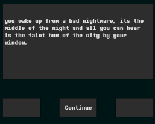

# Early Morning

Marciano Faugno

[View this project online](URL_FOR_THE_RUNNING_PROJECT)

## Description

Early morning is a narrative click through adventure with multiple endings and outcomes. The concept for the game takes inspiration from disco elysium, an in-depth narrative rpg. the game is very simple, with 3 interactable buttons that allow you to continue reading the dialogue and progress to the end. 

## Screenshot(s)

This bit should have some images of the program running so that the reader has a sense of what it looks like. For example:

> 

## Attribution

> - This project uses [p5.js](https://p5js.org).
> - The clown image is a capture of the clown from the Apple emoji character set.
> - The barking sound effect is "single dog bark 1" by crazymonke9 from freesound.org: https://freesound.org/people/crazymonke9/sounds/418107/
> - font from: https://www.behance.net/gallery/31268855/Determination-Better-Undertale-Font

## License

> This project is licensed under a Creative Commons Attribution ([CC BY 4.0](https://creativecommons.org/licenses/by/4.0/deed.en)) license with the exception of libraries and other components with their own licenses.