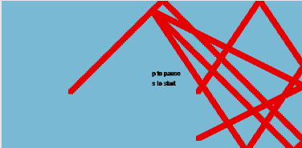

# Start / Pause

Marciano Faugno

[View this project online](URL_FOR_THE_RUNNING_PROJECT)

## Description

this is a very simple project that has 2 balls bounce around the canvas, leaving their trail behind them. you can start and pause the movement of the balls Using P to pause and S to start

## Screenshot(s)

> 

## Attribution

> - this foundation of this project was built from the Function-challenge done in class by pippin
> - This project uses [p5.js](https://p5js.org).
> - The clown image is a capture of the clown from the Apple emoji character set.
> - The barking sound effect is "single dog bark 1" by crazymonke9 from freesound.org: https://freesound.org/people/crazymonke9/sounds/418107/

## License

This bit should include the license you want to apply to your work. For example:

> This project is licensed under a Creative Commons Attribution ([CC BY 4.0](https://creativecommons.org/licenses/by/4.0/deed.en)) license with the exception of libraries and other components with their own licenses.